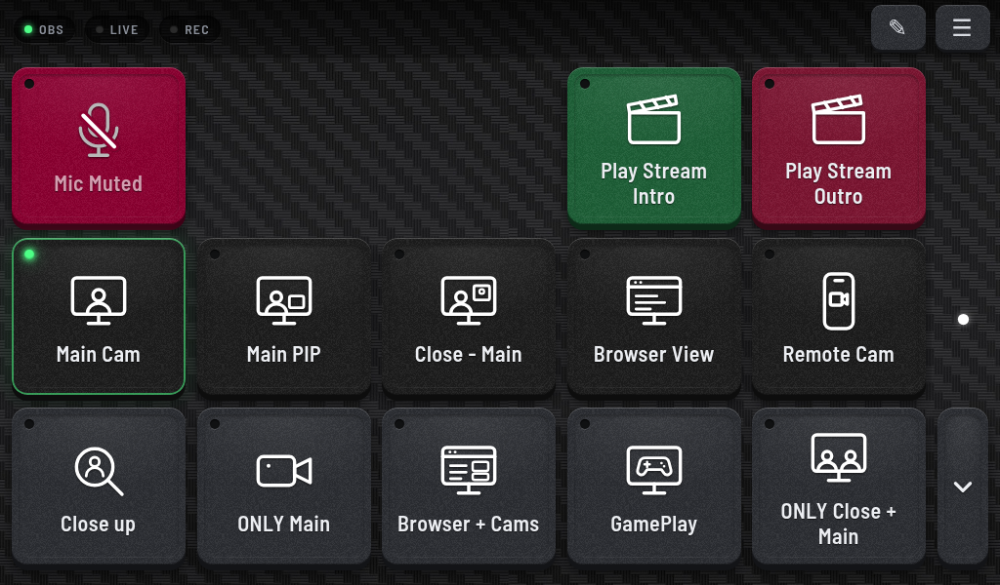
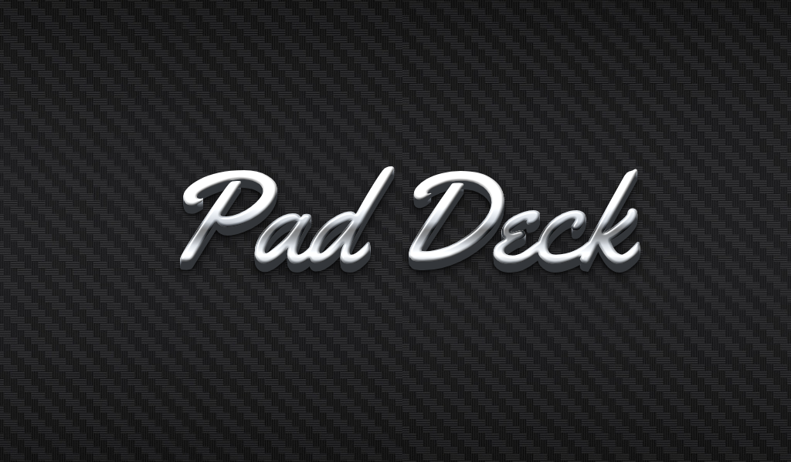
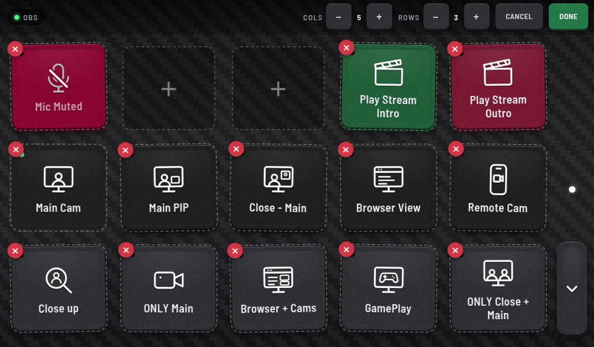
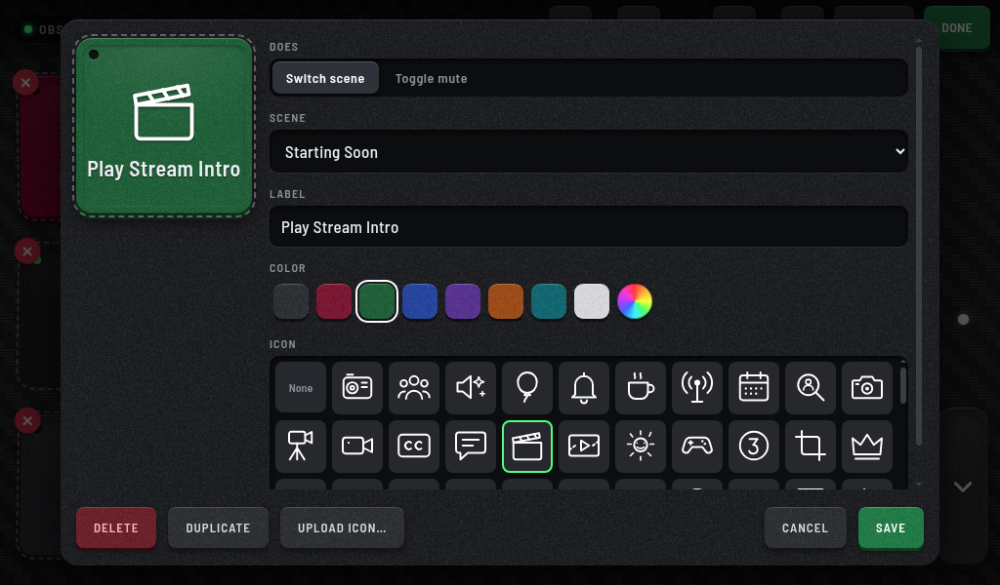
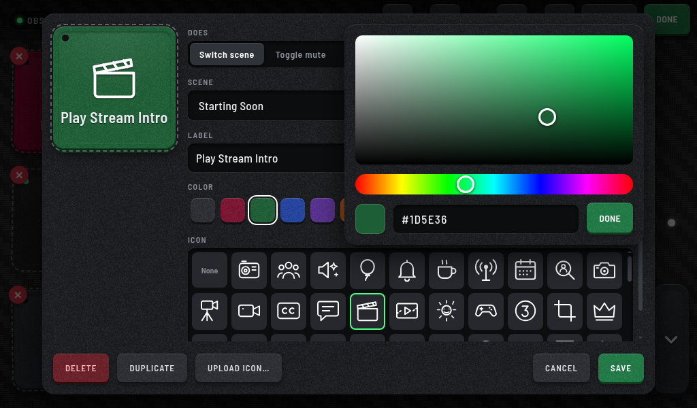
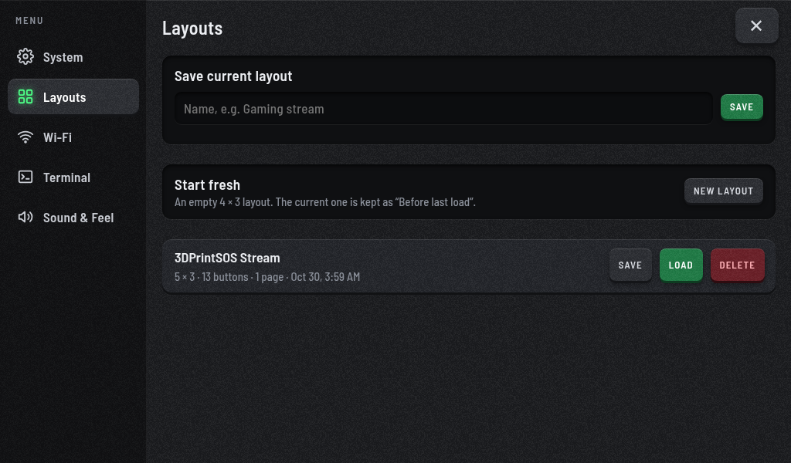
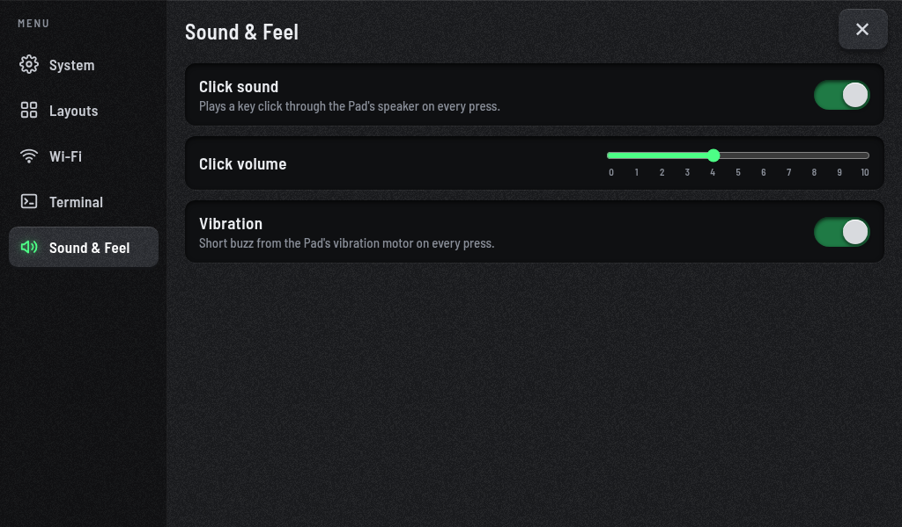
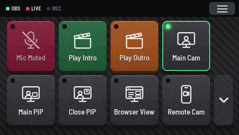
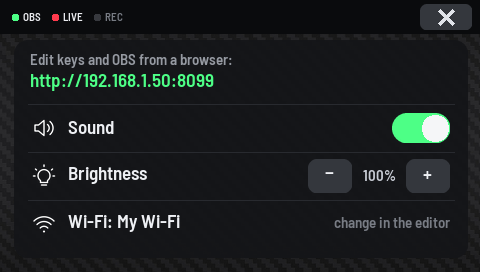

# Pad Deck

**A tactile, touch-first stream deck for OBS, built for the BigTreeTech Pad 7.**
Big chrome-and-carbon keycaps that switch scenes and mute your mic, live status lights, and everything
editable right on the screen. No phone, no extra app, no subscription. The Pad talks to OBS over your network.
It also runs on the smaller **Creality Nebula Pad**: see [Pad Deck Lite](#creality-nebula-pad-pad-deck-lite).



## Features

- **One-tap OBS control:** keys switch scenes or toggle an audio input's mute. The live scene's key lights
  up green, and the bar shows OBS, Live and Rec status.
- **Physical keycaps:** a dished face, a weighted edge, a satisfying press, a plastic "click" through the
  Pad's speaker on press and release, and an optional buzz from the vibration motor.
- **Pages:** swipe up and down (the page follows your finger), or use the ▲/▼ rail. Swiping past the last
  page makes a new one; empty pages clean themselves up.
- **Edit on the device:** hold any key for 3 s or tap ✎. Keys wiggle iOS-style. Drag to rearrange,
  hold a key over ▲/▼ to carry it to another page, tap to edit, ✕ to delete (with a confirmation).
- **Button editor:** pick the scene or audio input, a label, a color (swatches or a full color picker) and
  an icon from a library of 114 matching line icons, or upload your own.
- **Any grid:** 1–8 columns × 1–8 rows. Shrink it and keys that no longer fit move to the next page.
- **Saved layouts:** save, overwrite, load and delete named layouts (grid included), or start fresh. Loading
  always keeps the previous layout as a backup.
- **Status lights:** the Pad's two top LEDs show OBS connected (green) and on air (red), dimmed to a glow.
- **Settings menu:** swipe left or tap ☰ for Wi-Fi (with an on-screen keyboard), a full terminal, sound
  and vibration, click volume (0–10) and system info and power.
- **Polish:** a chrome "Pad Deck" badge with a gleam on start-up, a hidden cursor, a 60 fps UI on a
  little ARM board.

| | |
|---|---|
|  |  |
|  |  |
|  |  |

## Hardware

- BigTreeTech **Pad 7** with a **CB1** compute module (1024×600 touch screen, speaker, vibration motor, RGB LEDs),
  or a **Creality Nebula Pad** ([Pad Deck Lite](#creality-nebula-pad-pad-deck-lite))
- OBS 28+ with the WebSocket server on (Tools → WebSocket Server Settings), on the same network

## Setup

You need a Mac, Windows or Linux computer with [Docker Desktop](https://www.docker.com/products/docker-desktop/)
running, and a microSD card.

**1. Build the SD card image.** One line: put your Wi-Fi name and password in the quotes.

```bash
curl -fsSL https://raw.githubusercontent.com/FedorSosnin/pad-deck/main/build-image.sh | bash -s -- "WiFi name" "WiFi password"
```

This downloads BigTreeTech's official CB1 image, adds your Wi-Fi and Pad Deck, and saves `pad-deck.img`.

**2. Flash it** to the microSD card with [Raspberry Pi Imager](https://www.raspberrypi.com/software/)
(Choose OS → Use custom) or [balenaEtcher](https://etcher.balena.io/), and put the card in the Pad 7's CB1.

**3. Power on.** The first start sets everything up by itself (about 10 minutes, with progress on screen)
and restarts into Pad Deck.

**4. Connect OBS.** In OBS, turn on Tools → WebSocket Server Settings → Enable WebSocket server. On the Pad,
the OBS screen opens on its own: type your computer's name or IP and tap **Save & connect**.

<details>
<summary>For tinkerers</summary>

- `PAD_DECK_SSH_KEY="ssh-ed25519 AAAA…"` before the command lets you SSH in as `deck`.
- Run it locally with `python3 server.py` and open <http://localhost:8099>.
- `setup/deploy.sh` pushes changes to a Pad, `setup/pull-from-pad.sh` backs its layouts up, and
  `setup/make-icons.py` regenerates the icon library.
</details>

## Creality Nebula Pad (Pad Deck Lite)

The same deck on Creality's 4.3" Nebula Pad: the same keycaps, icons, pages and OBS control, built for its
smaller screen. You arrange the keys and set up OBS and Wi-Fi from any browser, and pages change with the ▲/▼ keys.

| | |
|---|---|
|  |  |

**1. Root it.** Download [`NEBULA_ota_img_V6.1.0.29.img`](https://github.com/srvrguy/Creality-Nebula-Pad-Files/releases/tag/RootedFirmware),
copy it onto the USB stick that came with the Nebula, plug the stick in and tap **Upgrade**.

**2. Connect it to Wi-Fi** on its own screen, and note its IP address under Settings → Network.

**3. Install.** One line from your computer: put the Nebula's IP in, and type `creality` when asked for a password.

```bash
ssh root@NEBULA-IP 'python3 -c "import urllib.request as u; exec(u.urlopen(\"https://raw.githubusercontent.com/FedorSosnin/pad-deck/main/nebula/get.py\").read())"'
```

**4. Connect OBS.** Open `http://NEBULA-IP:8099` in a browser, choose ☰ → OBS and enter your computer's name or
IP. Tap ✎ there to add your keys.

Run the same line again to update. To put Creality's screen back:
`ssh root@NEBULA-IP sh /usr/data/pad-deck/uninstall.sh`. The Nebula runs on 5 V, so without a printer power
it from its own 5 V connector.

## Credits

Made by **Fedor / 3DPrintSOS**: [youtube.com/@3DPrintSOS](https://www.youtube.com/@3DPrintSOS).

Fonts: Barlow Semi Condensed and Yellowtail (SIL Open Font License). Terminal: xterm.js (MIT).
